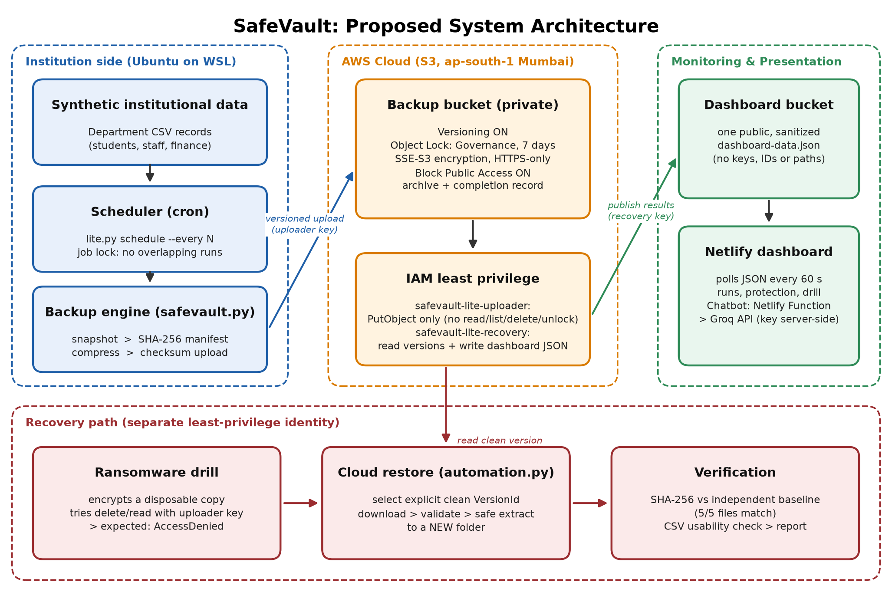

# SafeVault

**Automated, Ransomware-Resilient Backup of Institutional Data to Cloud Storage**

Cloud Computing group project (4 members). SafeVault takes automatic backups of a college department's data, checks every file with SHA-256 hashes, stores the backups in a locked and versioned Amazon S3 bucket, and proves that a clean copy can be restored, even if the computer that made the backup is attacked.

**Live dashboard:** https://dancing-gumdrop-8b4c47.netlify.app



---

## The problem

Department data is often backed up by hand to pen drives or shared folders connected to the same computers that hold the original data. Ransomware encrypts or deletes those backups too. Backups are rarely tested, and there is no easy way to prove a backup is complete, unchanged and restorable.

## What SafeVault does

| Feature | Command | What it proves |
|---|---|---|
| Dashboard login (username + password) | Netlify Functions `login`, `data`, `chat` | The dashboard and chatbot open only after sign-in; the password is checked server-side against a salted PBKDF2-SHA256 hash; signed tokens expire after 60 minutes; 5 wrong passwords lock the user for 5 minutes |
| File type identification | `python3 lite.py categories` | Every file is classified (records, documents, text, web, images, archives, binary, empty) by extension **and** content; mismatches and ransomware-style names are flagged |
| Fetch by category | `python3 lite.py fetch --category records` (or `--file PATH`, `--list`) | Only that category is fetched from the clean S3 backup into a new folder and verified by hash |
| Scheduled backups (cron on Ubuntu/WSL) | `python3 lite.py schedule --every 5 --install` | Run log with start, finish, outcome; no overlapping runs |
| One backup | `python3 lite.py run-backup` | Compressed archive + SHA-256 manifest uploaded to S3 (versioned, Object Lock) |
| Verify protection | `python3 lite.py verify-protection` | Versioning, Object Lock, retention, encryption and public-access block, read live from AWS |
| Cloud recovery | `python3 lite.py cloud-restore` | A chosen clean version is downloaded, restored to a new folder and matched 5/5 by hash against a separate baseline |
| Safe ransomware drill | `python3 lite.py ransomware-drill` | A disposable copy is encrypted; the uploader key is denied read, list, delete and unlock; recovery is verified |
| Status | `python3 lite.py status` | Summary of runs and checks in the terminal |
| Publish results | automatic, or `python3 lite.py publish` | Sanitized `dashboard-data.json` for the dashboard (no AWS keys, account IDs, bucket names or home paths) |
| User dashboard: My Files | `website/index.html` + `netlify/functions/data.mjs`, `file.mjs` | Every file in the clean backup with its type, size, upload and fetch history, SHA-256, preview and **download** (bytes re-checked by SHA-256 on the server) |
| User dashboard: Activity | automatic | One timeline of uploads, fetches, restores, type checks and drills, with the files involved |
| User dashboard: Ransomware Drill | automatic after `ransomware-drill` | Step-by-step replay: normal files → renamed to `.locked` and scrambled → stolen key gets AccessDenied → each file restored from S3 and verified |
| Dashboard + chatbot | `website/index.html`, `netlify/functions/` | Sign-in page, then results refreshing every 60 s; Groq chatbot behind a server-side function |

## Architecture

```
cron (Ubuntu/WSL) -> lite.py run-backup -> safevault.py engine -> AWS CLI (uploader: upload only)
      -> private S3 backup bucket  [Versioning, Object Lock Governance 7 days, SSE-S3, HTTPS-only, Block Public Access]

lite.py cloud-restore / ransomware-drill -> AWS CLI (recovery user: read backups only)
      -> download exact versions -> validate -> extract to a NEW folder -> compare hashes with clean baseline

every command -> sanitized results -> public dashboard bucket (one JSON file)
      -> Netlify dashboard (polls every 60 s) + chatbot (Netlify Function -> Groq, key kept server-side)
```

There is no conventional database. The dashboard is static HTML that gets one sanitized JSON file from S3 through the token-gated `data` function. The only backend is a set of Netlify Functions (login, data, file download and chatbot); the Groq key and login secrets live in Netlify environment variables, never in the browser.

## Dashboard login and file categories

**Dashboard login.** The dashboard shows a sign-in screen first. The `login` Netlify Function checks the username and password against `DASHBOARD_USERS`, a server-side environment variable that holds only salted PBKDF2-HMAC-SHA256 hashes (310,000 iterations), made with `python3 scripts/make_dashboard_user.py`. On success it returns a token signed with HMAC-SHA256 (`SESSION_SECRET`) that expires after 60 minutes. The `data` function returns the results and the `chat` function answers only when the token is valid. Five wrong passwords lock that user for 5 minutes. The browser never sees a password hash or the secret.

**File categories.** `catalog.py` reads each file's extension and its first bytes (magic numbers such as `%PDF`, PNG, ZIP, GZIP) and whether it is readable text. The category is saved in the backup manifest for every file, so the cloud copy records what type of data it holds. After the ransomware drill, `categories --folder <drill folder>` flags every `.locked` file as suspicious.

## Security design

- **Off-site copies** in Amazon S3, Mumbai region (`ap-south-1`).
- **Versioning + Object Lock (Governance, 7 days):** old versions cannot be overwritten or deleted during retention.
- **Least-privilege IAM:** the uploader can only upload (it cannot read, list, delete or unlock backups); a separate recovery user can only read.
- **Integrity:** SHA-256 manifest for every file, checked again after restore.
- **Encryption:** SSE-S3 at rest, HTTPS-only bucket policy in transit.
- **Privacy:** published results never include AWS keys, account IDs, bucket names or home paths, and only synthetic data is used.
- **Dashboard login:** server-side password check against salted hashes, signed expiring tokens, lockout.

## Tech stack

Python 3 · Ubuntu on WSL · cron · AWS CLI · Amazon S3 · AWS IAM · Netlify (static hosting + Functions, Node.js) · Groq API

## Repository structure

```
Safevault/
├── safevault.py            backup/restore engine: snapshot, SHA-256 manifest, versioned upload, safe extract
├── lite.py                 lab commands (entry point for all commands)
├── automation.py           scheduling, cloud restore, protection check, ransomware drill, dashboard publisher
├── catalog.py              file type / category detection and fetch by category
├── netlify.toml            Netlify settings for the site and functions
├── website/index.html      dashboard
├── netlify/functions/      login.mjs, data.mjs, file.mjs, chat.mjs (login, results, file downloads, chatbot)
├── netlify/lib/auth.mjs    password hash check and signed tokens
├── scripts/make_dashboard_user.py   makes a hashed dashboard login for Netlify
├── scripts/install_cli.py  AWS CLI install helper
├── tests/                  60 offline tests + simulated AWS CLI (tests/fakeaws/aws)
├── docs/SETUP.md           step-by-step AWS, cron and Netlify setup
├── docs/offline-test-output.txt   output of the 60 offline tests
└── report/                 architecture diagram
```

## Getting started

```bash
# Ubuntu / WSL, Python 3 and AWS CLI configured with the SafeVault IAM users
git clone https://github.com/Armstrong24/Safevault.git
cd Safevault
python3 -m unittest discover -s tests     # 60 offline tests, no AWS needed
sudo service cron start
python3 lite.py schedule --every 5 --install
python3 lite.py status
```

Full setup steps, including the IAM users, the dashboard and the chatbot, are in [`docs/SETUP.md`](docs/SETUP.md).

## Testing

- 60 automated offline tests, including an end-to-end run against a simulated AWS CLI ([output](docs/offline-test-output.txt)).
- Real runs on our AWS account: protection verified, cloud restore matched 5/5 files by hash, ransomware drill passed.

## Honest scope

A tested prototype using **synthetic institutional data only**. Scheduling works only while the laptop and WSL are on. Governance-mode retention can be bypassed by a specially authorised administrator. Recovery runs on the same laptop using a separate read-only identity; a production system would restore on a separate clean machine. SafeVault is ransomware-resilient under the threat model we tested, **not ransomware-proof**.

## Future scope

- Run backups on AWS Lambda or EC2 so they work when the laptop is off
- CloudWatch and SNS alerts when a backup fails
- Compliance-mode Object Lock for critical data
- Copies in another region or account (3-2-1 rule)
- S3 Glacier for old backups
- Database (MySQL) backups
- Detect suspicious file changes before backup
- Restore on a separate clean VM with MFA
- Multiple departments with separate dashboards
